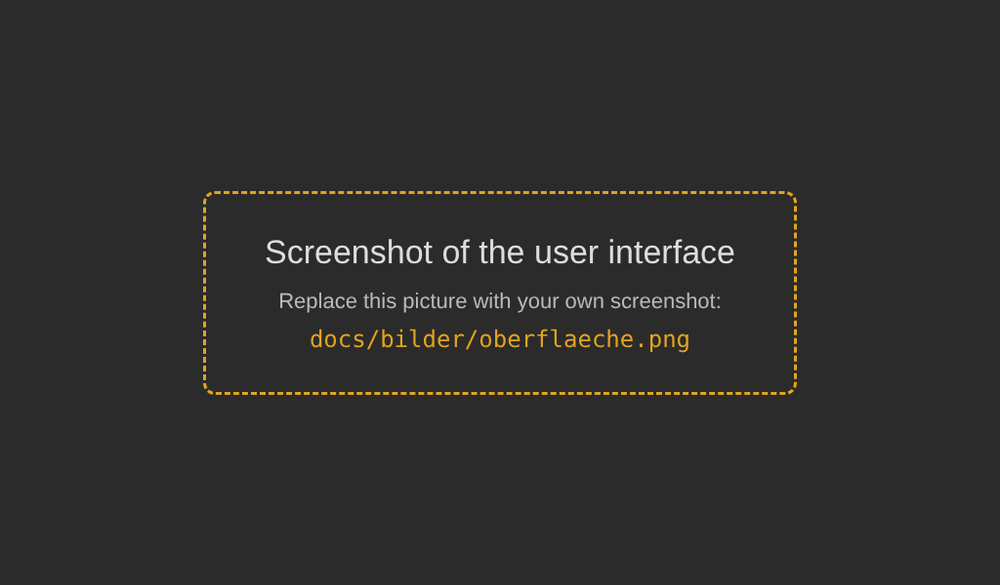

# Drehzyklen für LinuxCNC / gmoccapy

Zyklenprogrammierung für Drehmaschinen. Du stellst Zyklen in einer Liste zusammen, prüfst Vorschau,
Abtrag und Parameterbild und erzeugst daraus das fertige CNC-Programm (`.ngc`). Das Programm läuft
als **Benutzer-Tab in gmoccapy** (ab 1024×768) oder als **eigenes Fenster**.

Die Oberfläche ist standardmäßig **englisch**; Deutsch und Spanisch lassen sich unten rechts in der
Bedienleiste jederzeit umschalten (siehe [Sprache](#sprache)). Die Begriffe in dieser Anleitung
entsprechen der deutschen Übersetzung. Wie das Programm intern arbeitet, beschreibt
[docs/ARCHITEKTUR.md](docs/ARCHITEKTUR.md).

## Oberfläche



*(Eigenen Screenshot als `docs/bilder/oberflaeche.png` speichern – er erscheint dann hier.)*

- **Oben:** Knöpfe für Rohteil, die Zyklen, Werkzeuge und (ohne laufendes LinuxCNC) Maschine.
  Die Symbole richten sich nach der Werkzeuglage (vor oder hinter der Drehmitte).
- **Links – Programm:** die Schritte des Programms; ▲ ▼ verschieben, ✎ (oder Doppelklick)
  bearbeiten, ⧉ duplizieren, ✖ löschen. Wählst du oben einen anderen Zyklus, wird die Markierung
  in der Liste aufgehoben – „✔ Übernehmen“ gilt nur für den gerade bearbeiteten Schritt.
- **Mitte – Parameter:** Knöpfe **Außen | Innen**, die Eingabefelder und „＋ Zum Programm“. Der
  Knopf ist nach dem Anfügen gesperrt, bis du einen Parameter änderst.
- **Rechts – Ansicht:** Knöpfe **Zyklus | Bild | G-Code | Programm**. Die Vorschau zeigt Rohteil,
  Futter und Abtrag (orange); Mausrad: Zoom, linke Maustaste: verschieben, Doppelklick:
  zurücksetzen. „G-Code“ springt zum Code des links markierten Programmschritts.
- **Spalten:** Programm- und Parameterspalte sind schmal, ihre Breite stellst du mit den Griffen
  zwischen den Spalten ein. Den Rest bekommt die Vorschau.
- **Unten:** Neu, Öffnen, Speichern, G-Code, Sprache, Maschine, Laden.

## Einheitliche Bezeichnungen

| Zeichen | Bedeutung |
|---|---|
| **D** | Durchmesser Start |
| **d** | Durchmesser Ende |
| **Z1** | Z Start |
| **Z2** | Z Ende |

Die eingegebenen Werte bestimmen die Richtung:
- **Z1 > Z2:** Bearbeitung nach −Z (von rechts nach links)
- **Z1 < Z2:** Bearbeitung nach +Z (von links nach rechts), z.B. Plandrehen einer Rückseite von
  Z10 nach Z50 bei Nullpunkt am Futter, mit linkem Werkzeug
- Längsdrehen außen braucht D ≥ d, innen D ≤ d.

## Zyklen

Alle Zyklen außer Bohren und G-Code haben den Schalter **Außen | Innen**.

| Reiter | Inhalt |
|---|---|
| Plan | D → d radial, Z1 → Z2 in Zustellungen ap. D > d: zur Mitte, D < d: nach außen |
| Längs | D → d zwischen Z1 und Z2. Kante am Anfang und Ende einzeln: keine, Fase oder Radius. Die Endkante darf größer sein als der Absatz und endet dann bei D |
| Konus | „Angabe über Enddurchmesser“ (D, d, Z1, Z2) oder „Winkel“ (D, d, Z1, α/2). Umschalten berechnet den fehlenden Wert. Ein fallender Konus (z.B. D44 → d30) wird je Ebene schräg am Kegel angefahren |
| Gewinde | G76 außen/innen, Z1 Gewindeanfang, Z2 Gewindeende, Zs Startpunkt. Abfrage von L vor E. Gewinde aus Tabelle: metrisch Regel/Fein, UNC, UNF, Whitworth BSW, Rohrgewinde G |
| Fase/R | Fase L × α (Winkel zur Z-Achse) oder Radius an Vorder- oder Rückkante. **Negativer Winkel = Fase an der Rückkante**; sie wird schräg angefahren |
| Kontur | freie Kontur, Ecken je Punkt, Bögen; Richtung = erster → letzter Punkt. Passen zwei gegenläufige Radien (z.B. R2 innen, R5 außen an einem kurzen Absatz) nicht auf die Strecke dazwischen, gehen sie tangential ineinander über |
| Bohren | durchgehend, Spanbruch oder Entspanen; Tiefe auf Spitze oder vollen Ø |
| G-Code | eigener Code zwischen zwei Zyklen, mit **Textbausteinen** |

Konus, Fase und Kontur schruppen ab dem **tatsächlich vorhandenen Material** (Abtragssimulation),
eine Rohteilangabe im Zyklus gibt es nicht mehr. Steht vor dem Konturanfang noch Planaufmaß, wird es
mitgeschruppt.

### Drehzahl / Vorschub
Die Auswahl „Drehzahl/Vorschub“ legt fest:
- G96 (Schnittgeschwindigkeit Vc) oder G97 (Drehzahl n)
- G95 (mm/U) oder G94 (mm/min)

Je nach Auswahl ändern sich Beschriftung und Einheit von S und F. Beim Umschalten werden die Werte
umgerechnet. Bei der Erzeugung gilt:
- G97-Drehzahlen werden auf die Maschinengrenzen begrenzt.
- G94-Vorschübe werden auf die langsamste Achse begrenzt.
- Bei G95 wird die Drehzahl so begrenzt, dass F·n die Achsgeschwindigkeit nicht überschreitet.
- G96 erhält D = Maximaldrehzahl der Maschine.

Die **Drehrichtung „auto“** ist M3 bei Werkzeug vor der Drehmitte und M4 bei Werkzeug dahinter.

### Kontur
| Eingabe | Bedeutung |
|---|---|
| `X Z` / `U W` | Gerade, absolut / inkremental (X = Durchmesser) |
| `R5`, `C2` | Eckenradius, Fase 45° an diesem Punkt |
| `C2 A30` / `C2 B30` | Fase 2 mm auf der ankommenden / abgehenden Kante, 30° zu ihr |
| `R0` | Ecke scharf lassen |
| `G2`/`G3 X Z R10` (`LA`) | Bogen mit Radius (langer Bogen > 180°) |
| `G2`/`G3 X Z I K` | Bogen über Mittelpunkt (relativ) |
| `G3 X Z TS` / `TE` | Bogen tangential am Anfang / Ende |
| `RND5` / `CHR2` | Radius/Fase an einem Bogen-Endpunkt |

## Rohteil

Im Reiter Rohteil – und nur dort – stellst du ein:
- Außen-Ø D und Innen-Ø d
- Ausspannlänge L ab Futter
- Nullpunkt an der Vorderkante (mit Planaufmaß a) oder am Futter
- Sicherheitsabstand s

Daraus folgt:
- D belegt „Ø Start“ in Plan- und Längsdrehen vor (innen: d).
- **Fahrten hinter die Futterfläche** sind bei Außenbearbeitung ein Fehler, bei Bohren und
  Innenbearbeitung eine Warnung.
- **Eilgänge durch Material**, das nach dem Zyklus noch steht, werden als Fehler gemeldet, z.B. bei
  falscher Reihenfolge oder vertauschten Z1/Z2.
- Innenzyklen ohne Vorbohrung melden „zuerst bohren“.

## Werkzeuge

**Mit LinuxCNC-Konfiguration** wird die `tool.tbl` aus `[EMCIO] TOOL_TABLE` gelesen:
- Aus Orientierung Q und den Winkeln I/J werden Plattenform, Hand (links/rechts) und Lage
  (außen/innen) abgeleitet.
- Eine symmetrische Spitze mit 55° oder 60° (z.B. I117.5 J62.5) gilt als Gewindewerkzeug mit diesem
  Spitzenwinkel. Liefert die Tabelle die Winkel, bleiben Hand, Lage und Winkel fest; im Reiter
  Werkzeuge lässt sich dann nur der Typ ändern (z.B. eine 55°-Spitze als ISO D statt Gewinde).
- Geht das nicht (I = J = 0, Q = 0 oder 9), öffnet sich beim Start der Reiter Werkzeuge. Dort gibst
  du Typ, Hand und Lage an. Die Angabe wird gespeichert und **neu abgefragt, sobald sich die Zeile
  in der tool.tbl ändert**.
- Ändert LinuxCNC die tool.tbl (z.B. neues Werkzeug im Werkzeugeditor), liest **⟳ Einlesen** im
  Reiter Werkzeuge sie neu ein. Mit dem Schalter „Werkzeugtabelle bei Änderung automatisch
  einlesen“ im Reiter Maschine geschieht das nach spätestens 2 Sekunden von selbst (Standard: aus).
- Die Orientierung Q bestimmt die Richtung des Halters in der Grafik (Q7: Schaft nach +Z, wie in
  der LinuxCNC-Doku). Front- und Rückwinkel I/J werden mit Bogen ab Z+ eingezeichnet.
- **→ In tool.tbl schreiben** trägt das gewählte Werkzeug mit D, I, J, Q und Kommentar in die
  tool.tbl ein (X, Z und übrige Werte bleiben). Ein laufendes LinuxCNC lädt die Tabelle neu.
  Mit **＋ Neu** angelegte Werkzeuge stehen bis dahin nur in Drehzyklen. Winkel werden möglichst
  positiv geschrieben (0…360°); überstreicht die Platte Z+, wird der kleinere Winkel negativ.
- **Sonderform:** Typ „Sonderform“ wählen und Frontwinkel I und Rückwinkel J wie in der tool.tbl
  eingeben (im Uhrzeigersinn ab Z+), z.B. I120 J70 → Spitzenwinkel ε 50°. Hand und Lage ergeben
  sich daraus. „Werkzeugachse“ gibt an, in welchem Winkel der Halter eingebaut ist (leer =
  Winkelhalbierende, hier 95°); die Schneiden dürfen unsymmetrisch zur Achse stehen, z.B. 80°.
  Beim Schreiben in die tool.tbl wird Q auf die nächste der acht Richtungen gesetzt, die genaue
  Achse merkt sich Drehzyklen.
- Die Grafik zeigt jedes Werkzeug mit Schneidplatte, Halter, κ, ε und Schnittrichtung.
- Wenn ein bekanntes rechtes Werkzeug als linkes erscheint, schalte „Winkel I/J der tool.tbl in Z
  spiegeln“ um. Die Winkelkonvention der LinuxCNC-Doku („im Uhrzeigersinn ab Z+“) ist nicht
  eindeutig genug beschrieben, um das sicher festzulegen.

**Stand Alone** sind vorbelegt (`werkzeuge.json`, editierbar):
- ISO C, D, T und V, jeweils links und rechts
- Einstechwerkzeug, Gewindewerkzeug
- zusätzlich ein Bohrer und eine Bohrstange

**Plausibilitätsprüfung** in jedem Zyklus. Gemeldet werden unter anderem:
- Gewinde ohne Gewindewerkzeug (z.B. mit Form C)
- falsche Hand für die Schnittrichtung
- Außenwerkzeug für Innenbearbeitung
- zu wenig Freiwinkel für fallende Konturen

Das ist ein Fehler, den du mit **„Werkzeug trotz Warnung freigeben“** übersteuern kannst, z.B. für
Rund- oder Sondergewinde. Dann bleibt eine deutliche Warnung.

## Programmablauf

- **Werkzeugwechsel** immer mit `T… M6 G43`, nur bei neuer T-Nummer.
- **Wechselposition `G53`** aus `[CHANGE_POSITION]`, sonst `[EMCIO] TOOL_CHANGE_POSITION`, sonst
  Reiter Maschine. Angefahren wird im Radiusmodus G8, damit X dem INI-Wert entspricht; erst X,
  dann Z. Soll Z stehen bleiben (nur X anfahren), den Schalter „Werkzeugwechsel: auch Z anfahren“
  im Reiter Maschine ausschalten oder in `[CHANGE_POSITION]` nur `X` eintragen.
- **Zwischen den Zyklen** auf eine Rückzugsebene vor dem Werkstück:
  - außen: erst X nach außen
  - innen: erst X zur Mitte, dann Z heraus
- Programm in G7, G18, mm. G76 und Konturbögen stehen in G8, Bogenmittelpunkte relativ (G91.1).

## Gewinde aus Tabelle

Im Gewindezyklus Norm und Größe wählen (z.B. M12, M12x1, 1/4-28 UNF, 1/2-12 BSW, G1/2). Eingetragen
werden Ø, Steigung, Zustellwinkel (60°-Gewinde 29,5°, 55°-Gewinde 27°) und die Tiefe (automatisch
aus dem Grundprofil). Alle Werte lassen sich danach von Hand ändern.

| | 60° (metrisch, UNC/UNF) | 55° (Whitworth, G) |
|---|---|---|
| Gewindetiefe außen | 0,6134·P | 0,6403·P |
| Gewindetiefe innen | 0,5413·P | 0,6403·P |
| Kern-Ø D1 (Feld D bei innen) | D − 1,0825·P | D − 1,2806·P |
| Vordrehen außen | D − 0,1·P | D − 0,1·P |
| Bohrung vordrehen innen | D1 + 0,1·P | D1 + 0,1·P |

Die Tabellen stehen in `drehzyklen/data/threads.json`. Eigene Gewinde trägst du in
`~/.config/drehzyklen/threads.json` ein (wird beim ersten Start mit einem Beispiel angelegt):

```json
{"norms": {"Own": {"label": "Eigene Gewinde", "angle": 60}},
 "threads": [{"norm": "Own", "name": "M12x0.75", "diameter": 12.0, "pitch": 0.75},
             {"norm": "UNF", "name": "7/16-28 special", "diameter_inch": 0.4375, "tpi": 28}]}
```

`diameter` (mm) oder `diameter_inch`, `pitch` (mm) oder `tpi`, optional `angle`. Gleicher Name in
gleicher Norm ersetzt den mitgelieferten Eintrag. Die Werte werden wie bei den Normgewinden
berechnet; ein ganz eigenes Gewinde gibst du wie bisher mit „frei“ ein.

Der Vordreh-Ø erscheint als Hinweis unter der Vorschau. Die Werte sind Faustformeln, sie liegen etwa
in der Mitte der Toleranzfelder 6g (Bolzen) und 6H (Mutter). Passt der Spitzenwinkel des Werkzeugs
nicht zur Norm (55° gegen 60°), meldet die Werkzeugprüfung das.

## G-Code bearbeiten

- Die Taste **G-Code** zeigt den erzeugten Code in einem Editor. Dort ergänzen, speichern oder direkt
  in LinuxCNC laden (nur möglich, wenn LinuxCNC läuft).
- Dauerhafter Code zwischen zwei Zyklen gehört in einen Schritt **G-Code**. Einen Textbaustein
  auswählen ersetzt den Inhalt des Codefelds, **Einfügen** fügt ihn zusätzlich an der Schreibmarke
  ein, **Leeren** macht das Feld frei für einen neuen Baustein. Die Bausteine („Späne entfernen“,
  „Nachmessen“, eigene über **Speichern …**) stehen in `settings.json`.
- „Spindel/Kühlung danach wieder einschalten“: Folgt ein Zyklus mit demselben Werkzeug, werden
  Drehzahl mit M3/M4 und M8 direkt nach dem Baustein wieder ausgegeben; bei einem Werkzeugwechsel
  schaltet der nächste Zyklus sie ein.
- Der **Programmordner** steht im Reiter Maschine (Standard aus `PROGRAM_PREFIX`). Ein Ordner, den
  es nicht gibt, wird nicht übernommen (auf Wunsch wird er angelegt). Danach merkt sich das
  Programm den zuletzt benutzten Ordner.
- Die **Schnittdaten** (Werkzeug, Drehzahl, Vorschübe, Zustellung, Aufmaße …) merkt sich jeder
  Zyklus getrennt für außen und innen, auch über einen Neustart hinweg (`settings.json`).
  „Werkzeug trotz Warnung freigeben“ wird bewusst nicht gemerkt.

## Installation

Kopiere den Ordner z.B. nach `~/linuxcnc/drehzyklen`. Du brauchst Python 3 und `python3-gi`
(GTK 3). Einstellungen liegen in `~/.config/drehzyklen`.

### In gmoccapy einbetten
Ergänze in der INI im Abschnitt `[DISPLAY]`:
```
EMBED_TAB_NAME = Zyklen
EMBED_TAB_LOCATION = ntb_user_tabs
EMBED_TAB_COMMAND = python3 /home/BENUTZER/linuxcnc/drehzyklen/start_drehzyklen.py --xid {XID}
```
Optional die Wechselposition für gmoccapy und die Zyklen:
```
[CHANGE_POSITION]
X = 60
Y = 0
Z = 250
```

### Eigenständig / ohne Oberfläche
```
python3 start_drehzyklen.py --ini ~/linuxcnc/configs/meine_drehe/meine_drehe.ini
python3 start_drehzyklen.py --gcode beispiel.dzp > teil.ngc
python3 start_drehzyklen.py --language de
```

Welche INI gelesen wird (Werkzeugtabelle `[EMCIO] TOOL_TABLE`, Grenzen, G53-Wechselposition):
1. `--ini` beim Aufruf
2. `INI_FILE_NAME` – setzt LinuxCNC, wenn es das Programm startet (eingebettet in gmoccapy)
3. die INI des gerade laufenden LinuxCNC (z.B. wenn das Programm im Terminal gestartet wurde)
4. die im Reiter Maschine unter „LinuxCNC-INI“ eingetragene Datei (Betrieb ohne LinuxCNC)

Welche Datei benutzt wurde, steht unten im Reiter Maschine.

## Sprache

- Die Auswahl unten in der Bedienleiste wechselt die Sprache **sofort**: die Oberfläche wird neu
  aufgebaut, Programm, Eingaben und der gerade bearbeitete Schritt bleiben erhalten. Die Wahl wird in
  `settings.json` gespeichert. Auch die Kommentare im erzeugten G-Code folgen der Sprache.
- Beim Start: `--language de` (oder `en`, `es`) setzt die Sprache und speichert sie.
- Gespeichert werden sprachunabhängige Schlüssel (z.B. `"side": "outside"`, `"speed_feed":
  "G96_G95"`). Projekte (`.dzp`), Werkzeugangaben und Schnittdaten aus älteren Versionen mit
  deutschen Werten werden beim Laden automatisch umgesetzt.
- Die Übersetzungen liegen als Gettext-Dateien in `drehzyklen/locale/` (`de.po`, `es.po`) und werden
  zur Laufzeit gelesen, ein Übersetzen mit `msgfmt` ist nicht nötig. Nach Textänderungen im
  Quellcode sammelt `python3 scripts/update_translations.py` alle `_("…")`/`N_("…")`-Texte in
  `drehzyklen.pot` und ergänzt fehlende Einträge in allen `.po`-Dateien (meldet „x von y
  übersetzt“).
- **Eigene Sprache:** `drehzyklen/locale/drehzyklen.pot` nach `fr.po` kopieren (in
  `drehzyklen/locale/` oder `~/.config/drehzyklen/locale/`) und übersetzen. Jede `.po`-Datei
  erscheint beim nächsten Start bzw. Sprachwechsel automatisch in der Auswahl. Der angezeigte
  Name kommt aus der Kopfzeile `"X-Language-Name: Français\n"`, sonst aus einer Liste
  gängiger Sprachen. Eigene Dateien bringt
  `python3 scripts/update_translations.py ~/.config/drehzyklen/locale/fr.po` auf den neuen
  Stand.

## Wichtig vor dem ersten Span

- Prüfe neue Programme in der Simulation (`configs/sim/gmoccapy/lathe_configs`) oder im Luftschnitt.
- G76 braucht einen Spindel-Encoder.
- Prüfe die Werkzeugzuordnung an einem bekannten Werkzeug (Grafik im Reiter Werkzeuge).

## Aufbau

```
start_drehzyklen.py          Start (Fenster, gmoccapy-Plug, Kommandozeile)
drehzyklen/cycles/           ein Modul je Zyklus, jedes beschreibt oben seine Werkzeugbahn
  facing.py longturning.py taper.py edgebreak.py contour.py thread.py drill.py gcodeblock.py
  params.py                  Feldbeschreibungen (P), Auswahlschlüssel, gemeinsame Parametergruppen
  base.py                    Basisklasse Cycle (Werte, Richtung, Drehzahl/Vorschub)
  turning.py                 TurningCycle, ContourTurner (Schruppebenen + Schlichtschnitt)
  toolcheck.py               passt das Werkzeug zur Kontur?
  stock.py                   Rohteil und Aufspannung
  program.py                 Program.generate(): Prüfungen, Kopf, Werkzeugwechsel, Abtrag
drehzyklen/geometry.py       Konturtext, Bögen, Ecken, Schruppebenen
drehzyklen/gcode.py          G-Code-Ausgabe, Spiegelung ins Arbeitssystem
drehzyklen/material.py       Abtragssimulation
drehzyklen/tools.py          Werkzeugtabelle (tool.tbl / Vorgaben), Schreiben in die tool.tbl
drehzyklen/threads.py        Gewindetabellen (data/threads.json + eigene)
drehzyklen/machine.py        Maschinendaten (machine.json + INI)
drehzyklen/settings.py       Sprache, letzter Ordner, Textbausteine, Schnittdaten
drehzyklen/i18n.py           Übersetzung (_(), N_(), Sprachwechsel), locale/*.po
drehzyklen/render.py         Vorschau mit Zoom
drehzyklen/helpdraw.py       Parameterbilder und Symbole
drehzyklen/tooldraw.py       Werkzeuggrafik
drehzyklen/drawtext.py       Text in Grafiken (Ersatz für fehlende Zeichen)
drehzyklen/widgets.py        GTK-Bausteine
drehzyklen/gui.py            Oberfläche, App (Sprachwechsel durch Neuaufbau)
drehzyklen/data/             threads.json, Programmsymbol drehzyklen.svg/.png
scripts/update_translations.py   Übersetzungsdateien aktualisieren
tests/test_core.py           Tests (python3 tests/test_core.py)
```

## Lizenz

Copyright (C) 2026 nieson@web.de

Dieses Programm ist freie Software: Du kannst es unter den Bedingungen der GNU General Public
License, Version 2 oder (nach deiner Wahl) jeder späteren Version, weitergeben und/oder verändern
– wie LinuxCNC und gmoccapy. Es wird OHNE JEDE GEWÄHRLEISTUNG bereitgestellt. Der vollständige Text
steht in der Datei `LICENSE`.
